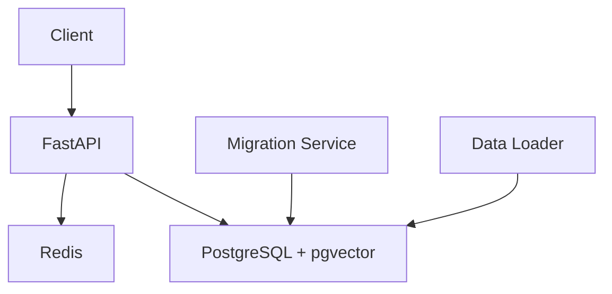
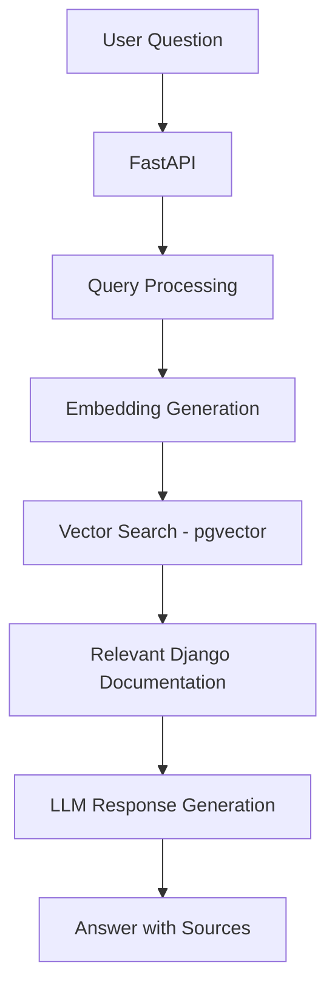

# DjangoDesk

**An AI-powered Django ORM performance and security assistant that answers developer questions using official Django documentation, with a goal of demonstrating executable ORM examples, generated SQL, and query performance.**

> **Project Status:** Day 4 completed — backend infrastructure, database integration, Docker, testing, and quality gates are implemented. RAG pipeline development begins in Day 5.

---

## Overview

DjangoDesk is an AI assistant designed to help Django developers understand ORM performance issues, database optimization, and security practices without having to search through large amounts of documentation manually.

It focuses on practical, reliable answers based on official Django documentation, with an emphasis on examples that developers can understand, run, and verify.

The long-term goal is to go beyond explanations by executing ORM examples against a sample database and showing the SQL generated, query counts, and performance improvements.

## The Problem

Django's ORM allows developers to interact with databases using Python instead of writing SQL directly. However, ORM queries can sometimes create hidden performance problems.

For example, accessing related objects inside a loop can cause the **N+1 query problem**.

```python
orders = Order.objects.all()

for order in orders:
    print(order.customer.name)
```

If there are 100 orders, Django may execute:

- 1 query to fetch orders
- 100 additional queries to fetch customers

This results in 101 database queries instead of potentially just 1 or 2.

Finding the right optimization can be difficult because Django documentation is extensive, version-dependent, and covers many different topics.

DjangoDesk aims to simplify this by providing focused explanations, optimized ORM examples, documentation references, and eventually executable demonstrations.

## Goals

- Answer Django ORM questions using official documentation.
- Explain database performance problems in beginner-friendly language.
- Identify inefficient ORM patterns such as N+1 queries.
- Recommend suitable ORM optimization techniques.
- Explain Django security practices.
- Support multiple Django LTS versions.
- Generate practical code examples.
- Eventually execute ORM examples and display generated SQL.
- Demonstrate query-count and performance improvements.

## Planned Signature Feature

### ORM-to-SQL Explorer

DjangoDesk aims to transform ORM optimization answers into verifiable demonstrations.

For a query such as:

> How can I fix the N+1 query problem when accessing customer details from orders?

The planned system will:

1. Explain the N+1 query problem.
2. Show the inefficient ORM implementation.
3. Execute the example against a sample database.
4. Display the generated SQL.
5. Show the original query count.
6. Apply an optimization using `select_related()`.
7. Execute the optimized version.
8. Compare the query count before and after.

### Example

**Before optimization**

```python
orders = Order.objects.all()

for order in orders:
    print(order.customer.name)
```

**After optimization**

```python
orders = Order.objects.select_related("customer")

for order in orders:
    print(order.customer.name)
```

The goal is to demonstrate the optimization with actual SQL and query counts rather than simply claiming that the code is faster.

---

## Tech Stack

| Technology     | Purpose                                   |
| -------------- | ----------------------------------------- |
| Python 3.12    | Primary programming language              |
| FastAPI        | API framework                             |
| PostgreSQL 17  | Database                                  |
| pgvector       | Vector database capabilities              |
| SQLAlchemy     | Database ORM and interaction              |
| Alembic        | Database migrations                       |
| Redis 7        | Caching and supporting infrastructure     |
| uv             | Python package and environment management |
| Docker         | Containerization                          |
| Docker Compose | Multi-service orchestration               |
| pytest         | Testing                                   |
| pytest-cov     | Test coverage                             |
| Ruff           | Linting and code quality                  |
| pre-commit     | Automated code quality checks             |

---

## Architecture

### Current Infrastructure



### Planned RAG Architecture



The RAG architecture is planned for upcoming development. The current project is focused on building and validating the backend foundation first.

---

## Project Structure

```text
DjangoDesk/
│
├── src/
│   └── djangodesk/
│       ├── api/
│       ├── db/
│       ├── config.py
│       └── ...
│
├── migrations/
│   └── versions/
│
├── scripts/
│   └── load_db.py
│
├── tests/
│   ├── unit/
│   └── integration/
│
├── docs/
│
├── Dockerfile
├── docker-compose.yml
├── pyproject.toml
├── uv.lock
├── .env.example
├── .dockerignore
└── README.md
```

> The project structure may evolve as the RAG pipeline and additional features are implemented.

---

## Getting Started

### Prerequisites

Make sure you have the following installed:

- Python 3.12
- [uv](https://docs.astral.sh/uv/)
- Docker Desktop / Docker Engine
- Git

---

## Running Locally

### 1. Clone the repository

```bash
git clone <YOUR_REPOSITORY_URL>
cd <YOUR_REPOSITORY_NAME>
```

### 2. Install dependencies

```bash
uv sync
```

### 3. Configure environment variables

Create your local `.env` file from the example:

**Windows PowerShell**

```powershell
Copy-Item .env.example .env
```

Update the environment variables according to your local database configuration.

> Never commit `.env` files or real credentials to GitHub.

### 4. Start the development server

```bash
uv run poe dev
```

### 5. Access the API

| Resource     | URL                                                          |
| ------------ | ------------------------------------------------------------ |
| API          | [http://localhost:8000](http://localhost:8000)               |
| Swagger UI   | [http://localhost:8000/docs](http://localhost:8000/docs)     |
| Health Check | [http://localhost:8000/health](http://localhost:8000/health) |

---

## Running with Docker

DjangoDesk uses Docker Compose to run the backend infrastructure and application services.

### Services

| Service   | Description                                      |
| --------- | ------------------------------------------------ |
| `api`     | FastAPI application                              |
| `db`      | PostgreSQL 17 with pgvector                      |
| `redis`   | Redis 7                                          |
| `migrate` | Runs database migrations and sample data loading |

### 1. Build the images

```bash
docker compose build
```

### 2. Start the services

```bash
docker compose up
```

This starts the required infrastructure, waits for healthy dependencies, applies database migrations, loads sample records, and starts the API.

### 3. Run in detached mode

```bash
docker compose up -d
```

### 4. View running services

```bash
docker compose ps
```

### 5. View logs

```bash
docker compose logs -f
```

To view logs for a particular service:

```bash
docker compose logs -f api
```

```bash
docker compose logs -f db
```

```bash
docker compose logs -f redis
```

### 6. Stop services

```bash
docker compose down
```

### 7. Stop services and delete database volumes

```bash
docker compose down -v
```

> **Warning:** The `-v` option removes Docker volumes, including the PostgreSQL volume containing your local database data. Use it only when you intentionally want to reset the database.

---

## Database

DjangoDesk currently uses PostgreSQL as its primary database.

### Database Features

- PostgreSQL 17
- pgvector extension support
- SQLAlchemy database integration
- Alembic migrations
- GIN index on metadata
- Dedicated test database configuration

### Migrations

Apply database migrations:

```bash
uv run poe migrate
```

Docker Compose also runs migrations through the migration service during startup.

### Sample Data

Load sample records:

```bash
uv run poe seed
```

The current Docker startup process successfully loaded 20 sample records.

---

## Testing

DjangoDesk uses pytest for automated testing.

### Run unit tests

```bash
uv run poe test
```

### Run integration tests

```bash
uv run poe test-integration
```

Integration tests require a dedicated PostgreSQL database configured through `TEST_DATABASE_URL`.

> Do not configure the integration test database to use a production database. The integration test setup creates and deletes its own test database.

### Run tests with coverage

```bash
uv run poe cov
```

The project enforces a minimum test coverage threshold of **70%**.

### Current Test Results

| Metric                                    | Result |
| ----------------------------------------- | -----: |
| Unit tests passed                         |     16 |
| Integration tests implemented             |      6 |
| Integration tests skipped without test DB |      6 |
| Test coverage                             | 81.94% |
| Minimum coverage requirement              |    70% |

---

## Code Quality

DjangoDesk uses Ruff for linting and pre-commit for automated code quality checks.

### Run Ruff

```bash
uv run poe lint
```

### Pre-commit

Run the configured checks:

```bash
pre-commit run --all-files
```

Quality checks are intended to keep the codebase consistent, maintainable, and reliable as new features are added.

---

## Available Commands

| Command                       | Description                  |
| ----------------------------- | ---------------------------- |
| `uv sync`                     | Install project dependencies |
| `uv run poe dev`              | Start development server     |
| `uv run poe lint`             | Run Ruff lint checks         |
| `uv run poe test`             | Run unit tests               |
| `uv run poe test-integration` | Run integration tests        |
| `uv run poe cov`              | Run tests with coverage      |
| `uv run poe migrate`          | Apply database migrations    |
| `uv run poe seed`             | Load sample records          |
| `docker compose build`        | Build Docker images          |
| `docker compose up`           | Build/start services         |
| `docker compose up -d`        | Start services in background |
| `docker compose down`         | Stop services                |
| `docker compose logs -f`      | Follow service logs          |

---

## Data Sources

DjangoDesk is designed to use official Django documentation as its primary knowledge source.

Planned sources include:

- Django documentation
- Django release notes
- Django LTS documentation
- Django security release notes
- ORM documentation
- QuerySet API reference
- Database optimization documentation

### Official Resources

- [Django Official Website](https://www.djangoproject.com/)
- [Django Documentation](https://docs.djangoproject.com/)
- [Django GitHub Repository](https://github.com/django/django)

Django documentation is available under its respective licensing terms. Refer to the official Django repository and documentation for license details.

---

## Development Roadmap

### Day 1 — Project Foundation

- Project initialization
- Python environment setup
- Core configuration
- Initial backend structure

### Day 2 — Backend Development

- Core API development
- Database foundation
- Configuration and application structure

### Day 3 — PostgreSQL Integration

- PostgreSQL setup
- SQLAlchemy integration
- Alembic migrations
- Database improvements

### Day 4 — Docker and Quality Gates

- Multi-stage Docker build
- Docker Compose services
- PostgreSQL and Redis infrastructure
- Migration service
- Automated data loading
- Unit and integration tests
- Coverage enforcement
- Ruff and pre-commit
- Docker verification

### Day 5 — RAG Foundations

- Document ingestion
- Text extraction
- Document processing
- Chunking strategy

### Upcoming

- Embedding generation
- Vector storage using pgvector
- Semantic search
- Retrieval pipeline
- LLM integration
- Answer generation with source references
- Django ORM optimization assistant
- Executable ORM examples
- Generated SQL viewer
- Query-count comparison
- Django security assistant
- Deployment

---

## Target Metrics

The project's primary target is to validate the quality and usefulness of its ORM optimization answers.

| Metric                                     | Target                        |
| ------------------------------------------ | ----------------------------- |
| ORM code answers that execute successfully | 90%+                          |
| Evaluation tasks                           | 30 ORM optimization tasks     |
| Query optimization claims                  | Verified using query counts   |
| Documentation grounding                    | Official Django documentation |
| Minimum automated test coverage            | 70%                           |

These are project goals, not current measured production results.

---

## Current Progress

- [x] Backend foundation
- [x] FastAPI application
- [x] PostgreSQL integration
- [x] SQLAlchemy setup
- [x] Alembic migrations
- [x] PostgreSQL GIN index
- [x] Sample data loading
- [x] Redis infrastructure
- [x] Docker multi-stage build
- [x] Docker Compose setup
- [x] Non-root Docker user
- [x] Unit tests
- [x] Integration tests
- [x] Coverage enforcement
- [x] Ruff linting
- [x] Pre-commit checks
- [x] Docker startup verified
- [x] Database migrations verified inside Docker
- [x] 20 sample records loaded successfully
- [x] API health check verified
- [ ] Document ingestion pipeline
- [ ] Text extraction
- [ ] Chunking
- [ ] Embeddings
- [ ] Semantic retrieval
- [ ] RAG pipeline
- [ ] LLM integration
- [ ] ORM-to-SQL execution engine
- [ ] SQL and query-count viewer
- [ ] Deployment

---

## Why DjangoDesk?

DjangoDesk is being built to solve a practical developer problem: understanding Django ORM performance and security without manually searching through large documentation pages.

Instead of relying only on AI-generated explanations, the project aims to combine:

- Official documentation
- Retrieval-based knowledge
- Practical code examples
- Executable demonstrations
- SQL visibility
- Query-count validation

The goal is to make answers not only understandable, but also verifiable.

---

## License

This project is currently under development. A project license will be added when the repository licensing is finalized.

---

**Built as a learning and engineering project focused on Python, backend development, databases, AI, and Retrieval-Augmented Generation (RAG).**
